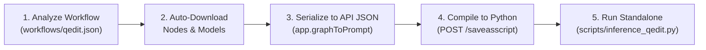

# Diffusive

A `uv`-managed, self-contained headless ComfyUI Python framework for compiling and running standalone AI video and image manipulation pipelines.

Both **ComfyUI core (`0.41.0.1`)** and the **ComfyUI-to-Python compiler (`2.1.0`)** are statically vendored inside `packages/` so the framework is completely immune to upstream breaking changes.

---

## Project Structure

```text
diffusive/
├── pyproject.toml                     # Root uv workspace configuration & local package sources
├── uv.lock                            # Locked dependency versions
├── .python-version                    # Pinned Python version (3.12)
│
├── packages/                          # Static, version-controlled core libraries
│   ├── comfyui/                       # Vendored ComfyUI core engine (v0.41.0.1)
│   └── comfyui-to-python/             # Vendored ComfyUI-to-Python compiler (pre-patched for uv)
│
├── docs/                              # Architecture, evolution log, & CLI cheatsheet
│   ├── ARCHITECTURE.md                # System design, static packages/, & JSON -> Python compiler guide
│   ├── CHANGELOG_AND_EVALUATION.md    # Chronological evolution log, bug fixes, & workflow traces
│   ├── COMMAND.txt                    # Quick copy-paste CLI cheatsheet
│   └── diagrams/                      # Excalidraw architecture & execution flow diagrams
│
├── models/                            # Static model directory tree (unet, text_encoders, vae, etc.)
├── custom_nodes/                      # Workflow custom nodes + symlink to packages/comfyui-to-python
├── workflows/                         # ComfyUI JSON workflows (Frontend UI & API formats)
│   ├── qedit.json                     # Frontend ComfyUI workflow (Qwen-Image GGUF)
│   └── qedit_api.json                 # Serialized Backend API JSON for qedit.json
├── input/                             # Input images, videos & audio files
├── output/                            # Generated images/videos, diff masks, and stacked videos
│
└── scripts/
    ├── inference_qedit.py             # Standalone Qwen-Image GGUF text-to-image script
    ├── inference_ifTalk.py            # Standalone Wan2.1 + InfiniteTalk V2V / lip-sync script
    ├── convert.py                     # Headless Playwright converter (Frontend JSON -> API JSON -> Python)
    ├── diff_masks.py                  # Frame-by-frame RGB difference mask & lossless MP4 generator
    ├── stack_video.py                 # Side-by-side batch video comparator (Original | Edited | Diff)
    ├── download_models.sh             # Downloads model weights defined in model_links.txt
    ├── model_links.txt                # Model URLs & target subfolders
    ├── download_custom_nodes.sh       # Clones pinned custom nodes & links packages/comfyui-to-python
    └── custom_nodes_links.txt         # Custom node GitHub URLs (with optional `@ <commit_sha>` pinning)
```

---

## Quick Start

### 1. Environment Setup

Install `uv` if not already installed, then sync the project environment (which installs `packages/comfyui` and `packages/comfyui-to-python` in editable mode):

```bash
uv sync --inexact
```

If you plan to compile frontend ComfyUI workflows into standalone Python scripts with `scripts/convert.py`, install the headless Chromium binary once:

```bash
uv run playwright install chromium
```

### 2. Download Custom Nodes & Models

Link the static `packages/comfyui-to-python` compiler, clone any workflow-specific custom nodes (with commit-hash pinning) into `./custom_nodes/`, and install their Python dependencies into `.venv`:

```bash
./scripts/download_custom_nodes.sh
```

Download all required model weights into `./models/`:

```bash
./scripts/download_models.sh
```

---

## End-to-End Walkthrough: Frontend JSON → Backend API JSON → Standalone Python (`qedit.json`)

ComfyUI stores visual graphs in a **Frontend Layout JSON** (`workflows/qedit.json`) containing node coordinates, UI links, and positional `widgets_values` arrays. Because the Python execution engine requires named parameters (`class_type` and key-value `inputs`), converting a frontend workflow into a standalone Python script follows a 5-step pipeline:



### Step 1: Analyze the Frontend Workflow JSON
Inspecting `workflows/qedit.json` reveals all required nodes, custom node packages (`properties.cnr_id` & commit `properties.ver`), and model filenames (`widgets_values`):

| Node ID | Node Type | Source (`cnr_id`) | Required Model / Role | Target Folder |
| :--- | :--- | :--- | :--- | :--- |
| `71` | `UnetLoaderGGUF` | `ComfyUI-GGUF` | `qwen-image-Q8_0.gguf` | `models/unet` |
| `38` | `CLIPLoader` | `comfy-core` | `qwen_2.5_vl_7b_fp8_scaled.safetensors` | `models/text_encoders` |
| `39` | `VAELoader` | `comfy-core` | `qwen_image_vae.safetensors` | `models/vae` |
| `6`, `7` | `CLIPTextEncode` | `comfy-core` | Positive & Negative prompt encoding | *(built-in)* |
| `58` | `EmptySD3LatentImage` | `comfy-core` | Empty latent batch (`1024x768`, `batch_size=2`) | *(built-in)* |
| `66` | `ModelSamplingAuraFlow` | `comfy-core` | AuraFlow shift (`3.5`) | *(built-in)* |
| `3`, `8`, `60` | `KSampler`, `VAEDecode`, `SaveImage` | `comfy-core` | Sampling (`10` steps, `euler`/`simple`), decoding & saving | *(built-in)* |

### Step 2: Configure & Run Auto-Downloaders
1. **Custom Nodes (`scripts/custom_nodes_links.txt`)**:
   `ComfyUI-to-Python-Extension` is vendored natively in `packages/comfyui-to-python/`. For external nodes, enable only what `qedit.json` needs and pin its exact commit hash from `qedit.json`:
   ```text
   https://github.com/city96/ComfyUI-GGUF.git @ b3ec875a68d94b758914fd48d30571d953bb7a54
   ```
   Run `./scripts/download_custom_nodes.sh`.

2. **Model Weights (`scripts/model_links.txt`)**:
   Configure the direct Hugging Face resolve links mapped to their target folders:
   ```text
   https://huggingface.co/city96/Qwen-Image-gguf/resolve/main/qwen-image-Q8_0.gguf | models/unet
   https://huggingface.co/Comfy-Org/Qwen-Image_ComfyUI/resolve/main/split_files/text_encoders/qwen_2.5_vl_7b_fp8_scaled.safetensors | models/text_encoders
   https://huggingface.co/Comfy-Org/Qwen-Image_ComfyUI/resolve/main/split_files/vae/qwen_image_vae.safetensors | models/vae
   ```
   Run `./scripts/download_models.sh` to automatically download and place each file in `./models/<subfolder>/`.

### Step 3 & 4: Convert Frontend JSON to Backend API JSON & Standalone Python
1. Start the headless ComfyUI server:
   ```bash
   uv run comfyui serve --guess-settings --listen 127.0.0.1 --port 8189
   ```
2. In another terminal, run `scripts/convert.py`:
   ```bash
   uv run python scripts/convert.py \
     --input workflows/qedit.json \
     --output scripts/inference_qedit.py \
     --url http://127.0.0.1:8189
   ```
   - Saves the serialized **Backend API JSON** to `workflows/qedit_api.json`.
   - Compiles the standalone Python script to `scripts/inference_qedit.py`.
3. Stop the ComfyUI server once conversion is complete.

### Step 5: Run the Standalone Python Backend Script
Verify that the ComfyUI runtime, custom nodes, and node mappings initialize properly without loading heavy weights using `--dry-run`:

```bash
uv run python scripts/inference_qedit.py --dry-run
```

Run the full standalone Qwen-Image generation pipeline headlessly:

```bash
uv run python scripts/inference_qedit.py \
  --output_prefix qedit_test \
  --steps 10 \
  --batch_size 1 \
  --device cuda:0
```

View all customizable CLI arguments (`--positive_prompt`, `--negative_prompt`, `--width`, `--height`, `--batch_size`, `--steps`, `--cfg`, `--shift`, `--seed`, `--device`, `--dry-run`):

```bash
uv run python scripts/inference_qedit.py --help
```

---

## Documentation (`docs/`)

* **[docs/ARCHITECTURE.md](file:///home/tmdt-admin/comfy/docs/ARCHITECTURE.md)**: System design, static `packages/` architecture, and Frontend JSON → Standalone Python compilation protocol.
* **[docs/CHANGELOG_AND_EVALUATION.md](file:///home/tmdt-admin/comfy/docs/CHANGELOG_AND_EVALUATION.md)**: Chronological evolution log, root-cause analysis of upstream ComfyUI fixes, and workflow evaluation traces (`qedit.json`, `inference_ifTalk.py`).
* **[docs/COMMAND.txt](file:///home/tmdt-admin/comfy/docs/COMMAND.txt)**: Copy-paste CLI command cheatsheet for setup, conversion, inference, and testing.
