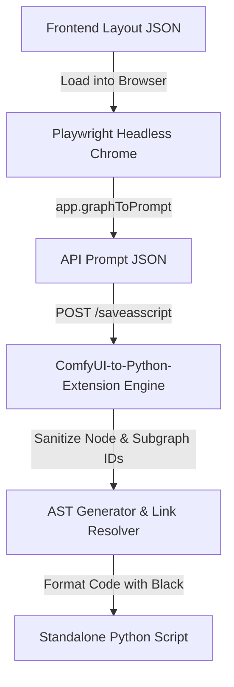

# ComfyUI Frontend-to-Python Compilation Walkthrough

This comprehensive, step-by-step guide explains how to compile ComfyUI frontend layout JSON files (`.json`) or backend API schemas (`.json`) into fully standalone, highly optimized Python scripts. Standalone compilation allows you to execute complex AI pipelines (like the Netflix VOID inpainting workflow) headlessly in pure Python, bypassing the browser graphical editor completely.

---

## 📖 Table of Contents
1. [Overview & Architecture](#1-overview--architecture)
2. [Prerequisites & Installation](#2-prerequisites--installation)
3. [Disabling Conflicting Legacy Extensions](#3-disabling-conflicting-legacy-extensions)
4. [Headless Conversion Automation Script](#4-headless-conversion-automation-script)
5. [Step-by-Step Execution Protocol](#5-step-by-step-execution-protocol)
6. [Troubleshooting & Pro-Tips](#6-troubleshooting--pro-tips)

---

## 1. Overview & Architecture

ComfyUI stores workflows in two distinct JSON formats:
*   **Frontend Layout JSON**: Contains coordinates, custom interface groups, and editor-specific subgraph mappings. It **cannot** be parsed directly by Python backend engines without first being serialized.
*   **API Prompt JSON**: Contains pure execution node parameters.

To convert a **Frontend Layout JSON**, we load the layout into a browser instance running ComfyUI, execute the editor's standard serialization (`app.graphToPrompt()`), and send the resulting prompt structure to the **ComfyUI-to-Python-Extension** backend endpoint (`/saveasscript`) for Python code compilation.



---

## 2. Prerequisites & Installation

To run the compilation, you need the modern, optimized version of the custom node package.

### Step 2.1: Clone/Verify the Extension
Ensure you have cloned `ComfyUI-to-Python-Extension` into your `custom_nodes` directory:
```bash
cd /home/tmdt-user/ComfyUI/custom_nodes/
git clone https://github.com/lucasb-eyer/ComfyUI-to-Python-Extension.git
```

### Step 2.2: Python Environment Compatibility
If you are running **Python 3.11** or lower, modify the `pyproject.toml` of the extension to relax its strict constraints:

> [!TIP]
> Modifying Python requirements prevents setuptools packaging crashes and allows smooth virtual environment installations under Python 3.11.

```toml
# custom_nodes/ComfyUI-to-Python-Extension/pyproject.toml
[project]
requires-python = ">=3.11"
```

### Step 2.3: Install the Custom Node
Activate your ComfyUI virtual environment and install the extension as an editable package:
```bash
cd /home/tmdt-user/ComfyUI/custom_nodes/ComfyUI-to-Python-Extension
uv pip install -e .
```

---

## 3. Disabling Conflicting Legacy Extensions

> [!CRITICAL]
> ComfyUI's custom node loader dynamically scans every subdirectory under `custom_nodes/` containing an `__init__.py`. Re-naming folder extensions like `.bak` **will not prevent ComfyUI from loading them**.

If you have legacy converters (e.g. `ComfyUI-SaveAsScript`), they will register conflicting `/saveasscript` route handlers. This causes compilation crashes due to their inability to sanitize modern subgraph node IDs (e.g., producing syntactically invalid Python variables like `cliploader_167:2` containing colons).

**Rule:** Move any conflicting directories **entirely outside** of the `custom_nodes/` workspace tree:
```bash
# Move completely outside of ComfyUI's path
mv /home/tmdt-user/ComfyUI/custom_nodes/ComfyUI-SaveAsScript /home/tmdt-user/ComfyUI_SaveAsScript.bak
```

---

## 4. Headless Conversion Automation Script

For absolute portability, use the following headless Playwright script to automate the full frontend loading, serialization, and compilation process. 

Save this script to your scratch directory as `convert.py`:

```python
# /home/tmdt-user/ComfyUI/scratch/convert.py
import asyncio
import json
import os
import sys
from playwright.async_api import async_playwright

WORKFLOW_PATH = "/home/tmdt-user/ComfyUI/workflows/void.json"
OUTPUT_SCRIPT_PATH = "/home/tmdt-user/ComfyUI/workflows/void_api.py"
COMFYUI_URL = "http://127.0.0.1:8188"

async def convert_workflow():
    if not os.path.exists(WORKFLOW_PATH):
        print(f"Error: Target workflow JSON not found at: {WORKFLOW_PATH}")
        sys.exit(1)

    print(f"Reading {WORKFLOW_PATH}...")
    with open(WORKFLOW_PATH, "r", encoding="utf-8") as f:
        workflow_data = json.load(f)

    async with async_playwright() as p:
        print("Launching headless Chromium...")
        browser = await p.chromium.launch(headless=True)
        page = await browser.new_page()

        print(f"Navigating to {COMFYUI_URL}...")
        await page.goto(COMFYUI_URL)

        # Wait for the ComfyUI frontend script to be fully hydrated
        print("Waiting for page load state to complete...")
        await page.wait_for_load_state("networkidle")
        await page.wait_for_timeout(3000)

        # Execute client-side deserialization and trigger route serialization
        python_script = await page.evaluate(f"""
            async (workflowJson) => {{
                // Clear active graph
                app.graph.clear();
                
                // Load JSON into visual graph editor
                await app.loadGraphData(workflowJson);
                
                // Wait briefly for custom nodes extensions in the UI to react
                await new Promise(resolve => setTimeout(resolve, 2000));
                
                // Serialize graph into API nodes
                const apiPrompt = await app.graphToPrompt();
                
                // Prepare request body
                const payload = {{
                    name: "compiled_workflow",
                    workflow: JSON.stringify(apiPrompt.output),
                    frontend_workflow: JSON.stringify(workflowJson)
                }};
                
                // POST request to SaveAsScript endpoint
                const response = await fetch('/saveasscript', {{
                    method: 'POST',
                    headers: {{ 'Content-Type': 'application/json' }},
                    body: JSON.stringify(payload)
                }});
                
                if (!response.ok) {{
                    const errText = await response.text();
                    throw new Error(`Failed to convert. Server returned status: ${{response.status}} - ${{errText}}`);
                }}
                
                return await response.text();
            }}
        """, workflow_data)

        print("Successfully received python script. Saving to file...")
        with open(OUTPUT_SCRIPT_PATH, "w", encoding="utf-8") as f:
            f.write(python_script)

        print(f"Stand-alone script successfully written to: {OUTPUT_SCRIPT_PATH}")
        await browser.close()

if __name__ == "__main__":
    asyncio.run(convert_workflow())
```

---

## 5. Step-by-Step Execution Protocol

Perform this protocol sequentially when compiling any workflow layout:

### Step 5.1: Boot the ComfyUI Server
Run your ComfyUI server in the background:
```bash
uv run python main.py --port 8188 --listen 127.0.0.1
```

### Step 5.2: Execute the Conversion Script
In a separate shell terminal, run the automation script:
```bash
uv run python scratch/convert.py
```
*Expected Output:*
```text
Reading void.json...
Launching headless Chromium...
Navigating to http://127.0.0.1:8188...
Waiting for page load state to complete...
Successfully received python script. Saving to file...
Stand-alone script successfully written to: /home/tmdt-user/ComfyUI/workflows/void_api.py
```

### Step 5.3: Execute Stand-Alone Code
Shutdown the background server and run your pure standalone script directly:
```bash
uv run python workflows/void_api.py
```

---

## 6. Troubleshooting & Pro-Tips

### Route Conflict / 500 Error
*   **Symptom:** Server returns `500 - Cannot parse` and points to variables containing colons (`:`).
*   **Resolution:** Check the backend shell server logs. Verify which path threw the traceback. Ensure no old packages are remaining in `custom_nodes/` (even if ended in `.bak` or `.old`). Move them out entirely.

### ModuleNotFoundError: `playwright`
*   **Symptom:** `No module named 'playwright'` when running the converter.
*   **Resolution:** Make sure dependencies are installed inside the virtual environment:
    ```bash
    uv pip install playwright
    uv run playwright install chromium
    ```

### Code Formatting Error
*   **Symptom:** Conversion passes, but throws an exception during `black` execution.
*   **Resolution:** Modern subgraphs represent nodes under `parent_node_id:child_node_id` strings (e.g. `"167:2"`). Ensure you are using the modern `ComfyUI-to-Python-Extension` which correctly uses `sanitize_node_id()` to translate colons to underscores (`167_2`).
