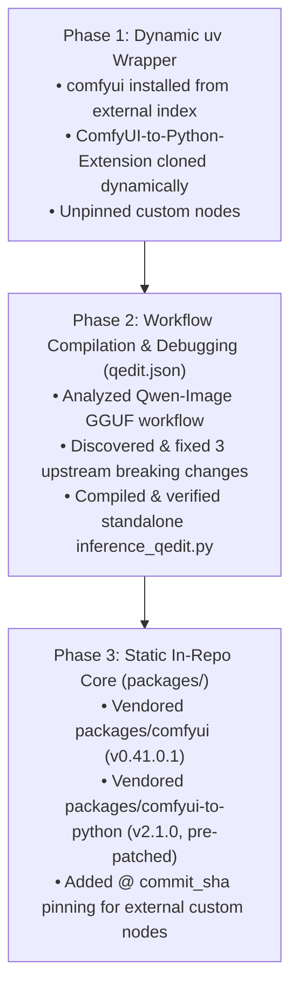

# Diffusive Architecture, Evolution & End-to-End Evaluation Trace

This document serves as the permanent architectural reference and historical ledger for **Diffusive**, tracing how the codebase evolved from a dynamic `uv` wrapper around external ComfyUI components into a **self-contained, static video and image manipulation framework**.

---

## 1. Architectural Evolution Timeline



### Phase 1: Initial State (Dynamic External Dependencies)
- `comfyui==0.41.0.1` was pulled from an external package index (`https://nodes.appmana.com/simple/`).
- `ComfyUI-to-Python-Extension` was listed inside `scripts/custom_nodes_links.txt` (originally pointing to a broken URL `lucasb-eyer/ComfyUI-to-Python-Extension.git`) and ignored by Git via `custom_nodes/*` in `.gitignore`.
- Every time `ComfyUI` or `pydn/ComfyUI-to-Python-Extension` changed upstream, fresh clones or environment rebuilds risked breaking the compilation pipeline.

### Phase 2: End-to-End Evaluation & Debugging on `workflows/qedit.json`
When testing the full pipeline on `workflows/qedit.json` (a 9-node Qwen-Image GGUF text-to-image workflow), we encountered and resolved three concrete incompatibilities between upstream `pydn/ComfyUI-to-Python-Extension` and `comfyui==0.41.0.1`:

1. **Setuptools Flat-Layout Build Failure**:
   - **Symptom**: `uv pip install -e custom_nodes/ComfyUI-to-Python-Extension` failed with `error: Multiple top-level packages discovered in a flat-layout: ['js', 'images', 'comfyui_to_python']` and a deprecated `project.license` table warning.
   - **Root Cause**: `pydn/ComfyUI-to-Python-Extension` omitted explicit `[tool.setuptools]` package discovery rules in `pyproject.toml`.
   - **Resolution**: Added explicit `[build-system]` and `packages = ["comfyui_to_python", "comfyui_to_python.generator"]` in `packages/comfyui-to-python/pyproject.toml`.

2. **`TypeError: cannot pickle '_thread.RLock' object` During `/saveasscript`**:
   - **Symptom**: Posting serialized API JSON to `/saveasscript` returned HTTP 500 at `copy.deepcopy(self.node_class_mappings)` in `comfyui_to_python/app.py`.
   - **Root Cause**: In modern packaged ComfyUI (`0.41.0.1`), `NODE_CLASS_MAPPINGS` is backed by a `comfy.execution_context` proxy containing unpicklable thread locks (`_thread.RLock`).
   - **Resolution**: Replaced `copy.deepcopy(self.node_class_mappings)` with a shallow dictionary snapshot `dict(self.node_class_mappings)` in `packages/comfyui-to-python/comfyui_to_python/app.py`.

3. **`ImportError: cannot import name 'init_extra_nodes' from 'nodes'`**:
   - **Symptom**: When a workflow contained a custom node (`UnetLoaderGGUF`), `ComfyUI-to-Python-Extension` tried to run `from nodes import init_extra_nodes`, which only exists in legacy git-checkout `nodes.py`, not in the packaged `comfy` runtime.
   - **Root Cause**: Packaged ComfyUI loads custom nodes via `comfy.nodes.package.import_all_nodes_in_workspace()` and stores them in `comfy.execution_context`.
   - **Resolution**: Baked the `uv`-compatible `bootstrap_comfyui_runtime()`, `import_custom_nodes()`, and `get_node_class_mappings()` directly into `packages/comfyui-to-python/comfyui_to_python/node_runtime.py` and updated `app.py` to refresh `self.node_class_mappings = self.node_mapping_loader()` after importing custom nodes.

### Phase 3: Static In-Repo Core (`packages/`)
To guarantee that neither `ComfyUI` nor `ComfyUI-to-Python-Extension` can ever break due to upstream changes or disappearing package indexes:
- **`packages/comfyui/`**: Contains the full Python source code of `comfyui==0.41.0.1` (`comfy`, `comfy_api`, `comfy_api_nodes`, `comfy_compatibility`, `comfy_config`, `comfy_execution`, `comfy_extras`) with its own `pyproject.toml`.
- **`packages/comfyui-to-python/`**: Contains the full source code of `ComfyUI-to-Python-Extension==2.1.0` with all Phase 2 fixes and `uv` runtime helpers permanently baked in.
- **Root `pyproject.toml` Wiring**:
  ```toml
  [tool.uv.sources]
  comfyui = { path = "packages/comfyui", editable = true }
  comfyui-to-python-extension = { path = "packages/comfyui-to-python", editable = true }
  ```
- **Custom Node Commit Pinning (`scripts/download_custom_nodes.sh`)**:
  - Automatically symlinks `custom_nodes/ComfyUI-to-Python-Extension -> ../packages/comfyui-to-python` so the ComfyUI server always loads the static in-repo compiler.
  - Supports `<GITHUB_URL> @ <COMMIT_SHA>` syntax in `scripts/custom_nodes_links.txt` so workflow-specific custom nodes (like `ComfyUI-GGUF @ b3ec875a68d94b758914fd48d30571d953bb7a54`) are pinned to the exact commit recorded in the workflow JSON.

---

## 2. Complete Evaluation Trace: `workflows/qedit.json`

### 2.1 Workflow Graph & Dependencies
`workflows/qedit.json` is a 9-node Qwen-Image text-to-image workflow:
- **Custom Node**: `UnetLoaderGGUF` (`ComfyUI-GGUF` at commit `b3ec875a68d94b758914fd48d30571d953bb7a54`)
- **Core Nodes**: `CLIPLoader`, `VAELoader`, `CLIPTextEncode` (x2), `EmptySD3LatentImage`, `ModelSamplingAuraFlow`, `KSampler`, `VAEDecode`, `SaveImage`
- **Model Weights**:
  1. `models/unet/qwen-image-Q8_0.gguf` (20.4 GB)
  2. `models/text_encoders/qwen_2.5_vl_7b_fp8_scaled.safetensors` (8.74 GB)
  3. `models/vae/qwen_image_vae.safetensors` (242 MB)

### 2.2 Artifacts Generated
1. **Backend API JSON**: [workflows/qedit_api.json](file:///home/tmdt-admin/comfy/workflows/qedit_api.json) — produced via Playwright headless Chromium executing `app.graphToPrompt()` inside `scripts/convert.py`.
2. **Standalone Python Script**: [scripts/inference_qedit.py](file:///home/tmdt-admin/comfy/scripts/inference_qedit.py) — compiled via `/saveasscript` with full CLI arguments (`--positive_prompt`, `--negative_prompt`, `--output_prefix`, `--width`, `--height`, `--batch_size`, `--steps`, `--cfg`, `--shift`, `--seed`, `--device`, `--dry-run`).
3. **Verification Results**:
   - **Dry-Run (`--dry-run`)**: Verified all 9 node classes initialize and resolve in standalone mode (`{'UnetLoaderGGUF': True, 'CLIPLoader': True, ...}`) importing directly from `packages/comfyui` and `packages/comfyui-to-python`.
   - **Full GPU Inference**: Executed `uv run python scripts/inference_qedit.py --batch_size 1 --steps 10 --output_prefix qedit_test` on an NVIDIA RTX A4000 (16 GB VRAM) with DynamicVRAM enabled; completed in **103.92 seconds** and wrote `output/qedit_test_00001_.png` (715 KB).

---

## 3. Documentation Index (`docs/`)

| Document | Purpose |
| :--- | :--- |
| [architecture_and_evolution.md](file:///home/tmdt-admin/comfy/docs/architecture_and_evolution.md) | This document: complete architectural history, root-cause analysis of upstream fixes, static `packages/` design, and `qedit.json` evaluation trace. |
| [comfyui_to_python_walkthrough.md](file:///home/tmdt-admin/comfy/docs/comfyui_to_python_walkthrough.md) | Deep dive into how Frontend Layout JSONs are serialized via Playwright (`app.graphToPrompt()`) and compiled into standalone Python AST code. |
| [implementation_plan.md](file:///home/tmdt-admin/comfy/docs/implementation_plan.md) | Initial `uv` workspace restructuring plan and checklist. |
| [uv_pip_comfy.md](file:///home/tmdt-admin/comfy/docs/uv_pip_comfy.md) | Reference notes on initial `uv pip` ComfyUI package installation. |
| `architecture_and_flow.excalidraw` | Visual Excalidraw architecture diagram of the workspace and conversion pipeline. |
| `inference_ifTalk_execution_flow.excalidraw` | Visual Excalidraw execution diagram of the `inference_ifTalk.py` video pipeline. |
